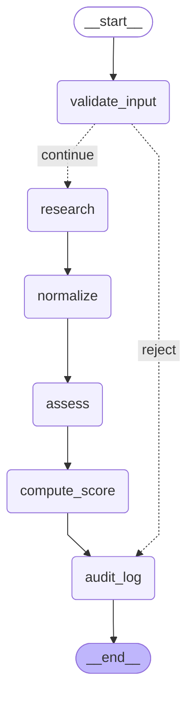

# Material para post: o esqueleto do agente (T13)

- O grafo do agente existe **antes** de qualquer prompt: 6 nós, ligados e testados com respostas fixas (stubs), sem chamar LLM nenhum.
- Dois nós são **código puro**, e não LLM: `validate_input` (contrato, sanitização e bloqueio de SSRF) e `compute_score` (rubrica determinística).
- Um teste garante o princípio do projeto, *o LLM extrai e o código pontua*: se um nó de LLM tentar devolver um score próprio ("confie em mim: tier A"), o `compute_score` sobrescreve.
- Lead inválido (campo extra como `"tier": "A"`, domínio apontando para IP interno) não chega à pesquisa: vai direto para a auditoria, registrado como `rejected`.
- O diagrama acima é gerado do próprio código (`scripts/export_graph.py`), e um teste falha se ele ficar desatualizado.
